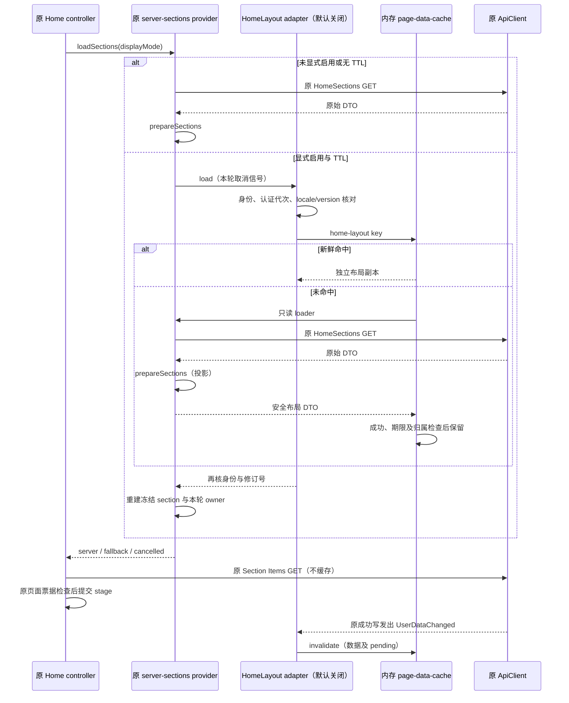

# 首页布局缓存适配：默认关闭的第二阶段

本阶段把首版缓存基础接到一条真实维护源码路径：HomeTab → 维护首页 controller → server-sections provider → **HomeSections 的既有安全投影**。只缓存分区布局，不缓存 Section Items、用户资料、继续观看/下一集的内容、媒体来源、图片、播放进度或认证请求。没有共享 API 包装、方法替换、依赖升级或页面重构。

## 真接线与默认值

| 接线 | 源码中的实际行为 | 本轮验证 |
| --- | --- | --- |
| HomeTab 入口 | 现有固定 overlay 仍加载 `enhanced/home/home-tab.js`，该维护模块新增对 `page-cache/home-layout-cache.js` 的相对 AMD 依赖。原 CardBuilder/router/connection 依赖与 owner 保留。 | 固定 HomeTab/app overlay 材料回归；维护 AMD 依赖图及 canonical events 单例检查。 |
| 开关 | Home controller 的 `dependencies.pageCacheOptions` 可注入 `{enabled:true, ttlMs, ...limits}`。普通调用点没有传此参数，因此默认关闭；显式隔离测试启动可经prepared preload传入选项；即使 enabled=true，未给 TTL 也不启用。关闭时不实例化数据缓存、不订阅事件、不改 API 方法。 | 默认关闭和无 TTL 的两次读取都实际走两次合成 GET；无新增监听器。 |
| 布局读取 | enabled 时 provider 只把 `prepareSections` 投影交给缓存，命中后再校验、冻结并分配本轮 WeakMap owner/随机种子；原始响应中的任意扩展、令牌、URL、Path、QueryOptions、UserData 不进入缓存。 | 原始合成响应带独立 canary，首次/命中输出和 stats 无 canary；未知/错误 schema 不缓存。 |
| 返回与刷新 | 同一个 HomeTab 的 pause/resume 保留成功布局、取消在途订阅；内容分区照常重新 GET。显式 refresh、resume({refresh:true}) 和外部 clear 先 invalidate；dispose 清数据和移除本适配器监听器。HomeTab 被销毁后不会跨实例复用。 | controller + provider + cache 的返回、显式刷新、过期、旧导航、销毁测试。DOM 与 itemscontainer 为测试替身。 |
| 身份 | 每次读取/交付核对当前 API 对象、server、user、isLoggedIn、既有 `_identityEpoch`；locale/服务端版本也分界。切换后创建新的空 session 绑定。启用路径的 provider section owner、Home 页面票据和已提交 stage 同样核对认证代次。 | 真正维护版 AMD ApiClient 的 setAuthenticationInfo/serverInfo、真实 CM logout、同用户重登、切用户/服务器/client；合成传输。 |
| 事件 | 原 CM 的 localusersignedin/localusersignedout/connected 清身份和缓存；原 API 的 message(UserDataChanged/LibraryChanged/UserUpdated/UserConfigurationUpdated) 与 websocketopen/websocketclose 失效。只读 MessageType，不读取或保留 Data。 | 真 ApiClient 收藏/已看/未看成功写发出的 UserDataChanged；其余事件通过真 events 模块合成派发。 |

最初开关只有源码级依赖注入；现补齐[显式隔离测试启动参数](PAGE_CACHE_TEST_ENTRY.md)，正常启动仍关闭，**没有新增可见设置页、持久化偏好或默认开启策略**。测试使用 100ms/10000ms 等 TTL；产品 TTL、容量和正式启用方式仍待用户确认。工程容量护栏沿用[首版方案](PAGE_DATA_CACHE.md)，本阶段没有将其认定为产品预算。

## 认证和写后失效的准确边界

- 正常 CM 退出在原 `api.logout()` 的 POST 结算、原 API 清认证后发出 localusersignedout，本适配器在该事件同步清缓存。没有包装或改变 logout，也没有宣称在用户发起退出的瞬间中止原退出 HTTP。在退出仍进行且旧身份仍有效的阶段，沿用原登录语义。
- 直接调用原认证 setter 而未发 CM 事件时，已有 `_identityEpoch`、用户及 isLoggedIn 检查在下次首页 resume/provider 读取或缓存交付边界退休旧上下文；旧在途回复不能通过提交 guard。没有轮询、读取/复制 token 或修改认证 setter；也不宣称对任何绕开原 API 的任意字段写入建立观察能力。
- `updateFavoriteStatus`、`markPlayed`、`markUnplayed` 的原成功链实际调用 onUserDataUpdated，发出 UserDataChanged。本阶段在该成功通知处清缓存、退休进行中的布局读，测试实际运行这些原 AMD 方法和合成 POST/DELETE；方法身份不变。失败写没有这条通知，布局缓存保留，测试明确覆盖。
- 本适配层只存布局，不含 Favorite/Played/PlaybackPosition/UserData；分区内容每次沿原路径读取，所以写失败、写进行中或播放进度更新不会把旧用户状态从本缓存带回卡片。没有安装通用“所有写开始前/所有写 finally”钩子，没有拦截播放上报。首版方案中的通用写前/写后双失效仍是未来**内容 DTO 缓存**的接线门槛，不能外推成本阶段已经完成的能力。
- API/CM 事件失效只清数据和在途缓存请求；可见内容更新继续由原首页、itemscontainer/refreshmonitor 与导航 owner 驱动，不另建自动重试或第二套 UI 刷新 owner。页面返回位置和焦点仍由原 scroller/焦点身份管理；本缓存不存 DOM 或 scrollTop。

## 时序与边界



provider 的取消集合同时持有布局缓存订阅和原 GET；pause/新刷新会先退休旧订阅。最后订阅取消、事件失效、上下文切换或期限结束均阻止旧值写缓存。迟到旧身份的失败/成功不能再清理新身份 binding。Home controller 对导航 epoch/view、账号/API 及启用路径认证代次的检查仍位于 DOM 提交前，不把“缓存 Promise 已完成”当成页面仍有效。

缓存只跨同一个被保留的 HomeTab 的返回；页面若被原 ViewManager 销毁，则 dispose 清空。命中布局不代表卡片请求减少、首屏速度提高或返回滚动体验已验收。

## 复现和证据等级

```sh
node --test tests/page-data-cache.test.cjs tests/home-layout-cache-integration.test.cjs tests/home-server-sections.test.cjs tests/home-server-rendering.test.cjs tests/home-server-rendering-material-selftest.cjs tests/item-lifecycle.test.cjs tests/movie-browser.test.cjs tests/search-browser.test.cjs tests/tracked-product-sources.test.cjs tests/web-overlay-preparation.test.cjs tests/build-input-contract.test.cjs tests/independent-apiclient-integration.test.cjs
```

其中 `home-layout-cache-integration` 使用实际维护/固定 AMD ApiClient、ApiClientEx、events、Credentials、CM、真实 provider/adapter/cache；Fetch 返回合成响应，不访问服务器。app.js 的 currentApiClient 选择器在夹具中提供，部分连接/WebSocket消息直接用真 events 模块派发；不把这种派发描述为真实服务器事件验证。

Home controller 测试运行真实维护 controller、provider、adapter、cache，document/itemscontainer/卡片为测试替身；另有固定 HomeTab overlay 与原动态导入别名合同、维护 AMD 图加载测试。它们不是完整 Alameda/客户端 GUI 运行、真实服务端登录/通知或原生滚动视觉证据。没有实际播放器、用户账户数据、NAS、安装器或系统配置操作，没有性能提升数字或命中率结论。

后续：确认 TTL/容量和首批功能范围；在真实 v0.4.0 发布点重基、复核全部来源/overlay与上述认证代次合同；当前已实现并获授权的显式测试CLI见[隔离启动合同](PAGE_CACHE_TEST_ENTRY.md)，后续做独立新包的Windows完整runtime、真实返回滚动及请求计数验收，不把测试参数认作产品设置。媒体列表、详情与内容 DTO 缓存继续未接入。
