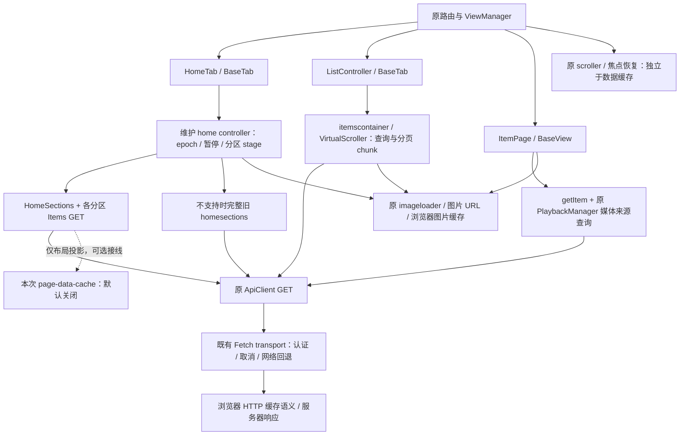

# 页面数据缓存：现状与实验基础

本方案面向正式版 v0.4.0 之后的功能。当前已有独立 AMD/CommonJS 内存模块，以及首页布局一条真实源码适配路径；**生产调用未传开关，默认关闭，没有设置 UI 或启用中的页面缓存**。第二阶段的真接线、合成测试和边界见[首页布局适配](PAGE_CACHE_HOME_ADAPTER.md)；不能据此宣称所有页面已经加速。正式启用前需重基真实发布点，并重新核对下列源码及 overlay。

## 当前加载与状态归属

以下为默认关闭路径的维护源码和固定 Web 材料静态清点；启用分支仅对布局增加可选命中。不是实际服务器请求计数、HTTP 命中率或耗时测量。



| 范围 | 源码入口 | 当前行为、重复请求机会与保护 |
| --- | --- | --- |
| 首页 | `src/electronapp/enhanced/home/home-tab.js`、`server-sections.js`；固定 `home/hometab.js` overlay | 已激活且未请求 refresh 的同轮 resume 复用 pending/已渲染状态。pause 退休轮次并取消，返回会重新读分区和内容、重建 stage。清理/刷新时旧 stage 退休；保留卡片/标题焦点身份。返回和重叠页面读是后续可测的去重机会，不能把不同 RandomSeed 当同一查询。 |
| 媒体列表 | 固定 `modules/tabbedview/listcontroller.js`、`modules/virtual-scroller/virtual-scroller.js`；维护 `enhanced/library/movie-browser.js` | 原 controller 合并筛选、排序和分页，itemscontainer/VirtualScroller 持有列表及 chunk 状态；恢复路径不等于每次全量读取。Movie 维护层保护请求 owner、暂停/销毁和刷新代次。跳页、字母索引、分区和搜索可能生成额外查询；是否重复须按完整参数实测。 |
| 详情 | 固定 `item/item.js`；`tools/patch-item-lifecycle.cjs` | onBeginResume 启动 Item 加载并通过原 PlaybackManager 取得媒体来源；子分区继续由原容器读取。ItemPage 保有 dataPromise/currentItem，不能视为跨页 TTL 缓存。维护 overlay 检查 view 与代次，防离页、重复刷新和选择器迟到回复；不保证底层全部 HTTP 物理取消。 |
| HTTP 与局部 DTO | `src/web-api/src/apiclient.js`、`mit-apiclient.js`、`transport.js` | GET 交给 Fetch，未新增通用 API 响应缓存；实际浏览器命中服从当前运行环境和响应头。用户资料使用按 server/user 键的既有 appStorage 缓存（60 秒新鲜度，旧值后台读/有限错误回退）；getUserViews 另有实例 Promise 复用及既有重置路径。均不代表页面缓存策略已统一，本次不改这些模块。 |
| 返回与图片 | 固定 `modules/viewmanager/{viewmanager,baseview}.js`、`modules/tabbedview/basetab.js`、`modules/emby-elements/emby-scroller/emby-scroller.js`、`modules/imageloader/imageloader.js` | ViewManager 的 isRestored 影响 refresh，BaseView/BaseTab 调用原 scroller 生命周期；虚拟列表保存自己的内容状态。图片继续走原 lazy/src/backgroundImage 和图片 URL；本次不另存图片、不改浏览器缓存目录。 |

## 小范围规则与接入门槛

1. 候选模块只认识 `home-layout`、`home-items`、`media-list`、`item-summary` 四个页面数据资源。它不是 URL/HTTP 缓存，不包装 ApiClient、不收请求头、不调用认证接口。接线者只能提供审核过的只读 GET loader 和页面 DTO 投影；不能把认证、用户资料、PlaybackInfo、媒体来源、播放进度或会话请求塞入这些资源。
2. 单个实例只持有当前上下文。调用 `bindContext({client, serverId, userId, session})`；client 是既有 API 对象，session 是每次登录重新创建的空对象，绝不能用 token 作 session 或 key。切服、切用户、退出前同步 `bindContext(null)`，再绑定新上下文；同账号重登也生成新 session。相同 server/user 不足以代表同一 API 或登录生命周期。非法替换上下文也清空旧账户数据。首页布局的真实事件/身份检查已经按[第二阶段合同](PAGE_CACHE_HOME_ADAPTER.md)接线但默认关闭；其他页面与通用内容 DTO 的生命周期钩子尚未安装。
3. 只允许显式 enabled 且资源有显式正 TTL 时缓存/去重。默认 enabled=false、无资源策略；关闭或未配置策略时每个调用独立加载，仍遵守上下文、取消、期限和 DTO 边界。资源名加规范化的完整 params 构成 key；params 必须包含显示模式、字段/投影版本、语言、排序、筛选、分页、随机种子等所有影响结果的值。loader 的第二参数是调用时捕获的 params 副本，构建实际查询应使用此副本，避免后续修改查询对象导致 key/请求不一致。同 key 必须代表同一种 loader 语义；不纳入滚动、焦点、令牌或原始 URL。
4. 只保留成功 plain JSON 的序列化快照，各消费者和命中各自解码，防止原卡片代码相互修改。拒绝循环、getter、稀疏数组、非 JSON、凭据/认证/请求头字段、URL 字段、MediaSources/PlaybackInfo 以及常见带 token 查询的字符串。此守卫不是任意敏感内容的检测器，不能代替接线者的 DTO 投影审查。错误、超时、取消、过期数据均不写入，不做陈旧错误回退。
5. TTL 从成功完成计；只在新鲜时命中，不后台续期；交付微任务再次核上下文、取消和 TTL。相同 key 的 pending 共享一个 loader，各订阅者独立取消；最后一人取消才 abort 共享 loader。期限、失效及退出也 abort，并立即结算等待者。即使 loader 忽略 signal，旧回复也不能写缓存或兑现给已退休消费者。这里只保证模块交付边界；await 之后的 DOM 提交仍须原页面 epoch/view owner 检查。
6. `invalidate()` 同时清数据并退休所有 pending。第一阶段优先整个当前上下文失效，避免漏掉列表、详情、首页之间的关联。收藏/已看/播放进度等写操作**开始前和结算后（含失败、取消）各失效一次**；外部 UserDataChanged/LibraryChanged/播放结束/重连也须接入失效。写进行中读取可能短暂见到服务端旧值，结算后失效与页面刷新必须由原写/页面 owner 执行。基础模块不拦截实际写接口或播放上报。第二阶段仅对不含用户状态的首页布局安装成功写通知等失效钩子，不代表内容 DTO 已有通用写前/写后接线。
7. 内存-only，无磁盘、localStorage、日志载荷或账户数据上传。LRU 限定保留条目及序列化 key+DTO 的 UTF-16 字节估算；这不是 JS 堆总内存限额，响应传输、解析、Promise 和消费者副本另计。进行中任务和每任务订阅者另有上限，超额返回 CacheCapacityError，不牺牲已有消费者。
8. 缓存不保存 DOM、scrollTop、焦点、选择器实例或虚拟 chunk 的 owner。页面恢复状态沿原 ViewManager/scroller/虚拟列表；数据淘汰不得悄悄改变返回位置。显式刷新先失效再走原刷新；图像、视频缓存、FNConnect、播放与 Session 链路不在本次范围。

## 测试参数与后续选择

工程护栏的构造默认值是 32 条、2 MiB 序列化估算、8 个 pending、每任务 64 个订阅者、5 秒加载期限；配置硬上限依次为 1024 条、32 MiB、128 个、1024 个、60 秒。资源 TTL 必须显式指定且不超过 5 分钟。这些是默认关闭实验的有限保护值，**不是确认后的逐页 TTL/容量产品策略**。测试中 100ms TTL 等值仅用于虚拟时钟断言。

当前首批适配仅为首页布局、默认关闭。未决：是否正式采用该首批范围；继续观看/下一集/收藏是否一律 bypass；不同资源的 TTL、空结果策略、条目和字节预算；大列表分块策略；语言/字段投影版本的完整 key；通知丢失与网络重连如何保守清理；真实返回滚动/焦点体验。建议先从只读首页布局（内容列表另取）的小试验开始，取得合成请求计数及用户确认后再逐页扩大，不给所有 GET 套永久缓存。

模块位置：[`page-data-cache.js`](../src/electronapp/enhanced/page-cache/page-data-cache.js)。直接 require 或 AMD 导出均为 `{create}`；没有应用依赖或新增 npm 包。

```js
// 只用于隔离原型；没有注册为用户设置或当前页面行为。
const pages = pageDataCache.create({
    enabled: true,
    policies: {'media-list': {ttlMs: 100}}, // 虚拟时钟测试值，不是建议产品 TTL
    maxEntries: 2
});
const session = {}; // 每次认证生命周期重新创建；不含令牌
pages.bindContext({client: existingApi, serverId, userId, session});
const result = await pages.load({
    resource: 'media-list',
    params: {StartIndex: 0, Limit: 24, Fields: 'Name', projectionVersion: 1},
    signal: pageAbort.signal,
    load: (signal, params) => loadApprovedSummaryDto(existingApi, params, signal)
});
// 此处仍需原页面代次/owner guard，才可把 result 交给原容器。
// 离开认证上下文前：pages.bindContext(null)。
// 写 owner 在实际写开始前和 finally 中各调用 pages.invalidate()。
```

## 复现和证据边界

`node --test tests/page-data-cache.test.cjs` 使用合成 DTO、可控 Promise、AbortSignal 和虚拟时钟，检查默认关闭、白名单、身份隔离、去重、独立取消、无视 abort 的迟到回复、写失效、TTL、LRU、序列化预算、pending/fanout 上限、DTO 隔离和敏感字段拒绝；AMD smoke 只证明导出，不代表真实应用 loader 接线。

相邻回归：`node --test tests/page-data-cache.test.cjs tests/home-server-sections.test.cjs tests/home-server-rendering.test.cjs tests/item-lifecycle.test.cjs tests/movie-browser.test.cjs tests/search-browser.test.cjs tests/tracked-product-sources.test.cjs tests/web-overlay-preparation.test.cjs tests/build-input-contract.test.cjs`。精确结果见项目状态/开发记录。

未执行：真实服务请求计数/命中率、账户切换 GUI、完整 runtime/Windows 安装器、页面性能或滚动视觉、真实播放/远控及长期内存。未使用旧成品黑箱或外部用户账户数据。两个缓存源模块可由既有 Git blob 装配器复制；第二阶段只改维护 Home controller/provider 的常规源文件，没有新增 overlay 或更改固定 overlay 输出身份，不能把源码测试冒充启用中的缓存验收。
